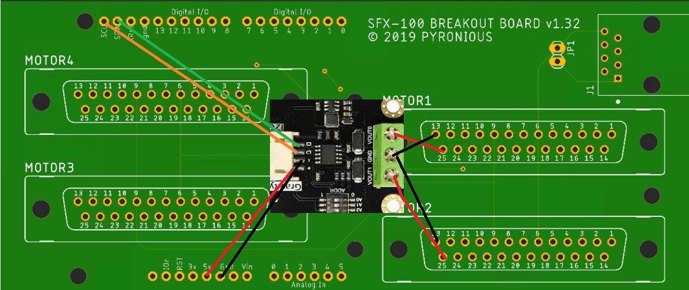

# AASD-15 / S2-SVD15 Advanced Torque-Based Belt Tensioner Guide

**WARNING: USE AT YOUR OWN RISK**

## Acknowledgements & Credits
Special thanks to the pioneers and creators of this hardware architecture:
- **OpenSFX project:** The fundamental root of the 3D-printed linear actuator mechanics.  
  URL: https://opensfx.com
- **Pyronious:** For simplifying the DB25 interface via his open-source Arduino Leonardo breakout shield.  
  URL: https://github.com
- **Jonas Lang:** First concept and implementation thread using AC servo torque-based control with an external DAC.  
  URL: https://virtualracing.org
- **Jacob (irTactile):** For providing deep protocol insights via his advanced hardware controller.  
  URL: https://github.com

---

## Hardware Modification (Torque Mode Transition)
By soldering a tiny **DFRobot GP8413 2-channel I2C DAC module** onto the underside of your original Pyronious shield, you can bypass position-based travel entirely and drive your actuators using pure analog **Torque Mode**.

Because the GP8413 module is so compact, it fits perfectly beneath the PCB, allowing you to reuse your original 3D-printed controller housing. Secure the DAC with electrical tape at the bottom right inside the case to guide the wires safely.

*⏱️ **Installation Time:** This modification requires soldering only 8 short jumper wires and takes approximately 15 minutes to complete for anyone with basic soldering skills.*

*🔄 **Reversibility:** No permanent cuts are made to the shield. You can always flash your Arduino Leonardo back to the original SimFeedback firmware to return to position mode.*

### Interfacing & Wiring

Connect the GP8413 module to the Arduino Leonardo I2C lines and DB25 breakouts as follows:

**Digital I2C Input (Breakout Shield to DAC):**
- **C** ──► Connect to SFX Shield SCL
- **D** ──► Connect to SFX Shield SDA (Pin 2)
- **GND (Ground)** ──► Connect to SFX Shield GND
- **VCC (Power)** ──► Connect to SFX Shield +5V

**Analog Output (DAC to DB25 Rails):**
- **VOUT 0 (Channel 0)** ──► Connect to Motor 1 DB25 PIN 25 (Vref Analog Input)
- **VOUT 1 (Channel 1)** ──► Connect to Motor 2 DB25 PIN 25 (Vref Analog Input)
- **GND (Analog)** ──► Connect to BOTH DB25 breakouts PIN 13 (GND/AGND Signal Ground). *(Note: You can bridge Pin 10 to Pin 13 if you are not using an SFX Shield).*

---

## 🛠️ AASD-15 Servo Driver Parameters
Original position-mode parameters (such as electronic gear ratios or pulse scaling) are completely ignored in torque mode.

Configure **both** servo driver displays to the following recommended settings:
- **Pn002 = 0** ──► Control Mode Selection: Hard-locked in Torque Mode
- **Pn008 = 300** ──► Internal Torque Limit (Forward)
- **Pn009 = 300** ──► Internal Torque Limit (Reverse)
- **Pn188 = 5** ──► Analog Input Filter Time (0.1 ms units). Increase up to 20 max if you encounter heavy EMI noise or belt vibrations.
- **Pn189 = 30** ──► Analog Torque Command Gain. Set to 30 to perfectly scale 300% maximum peak torque over the full 10.0V DAC output.
- **Pn191 = 0 (or 1)** ──► Change this parameter if you need to invert your physical motor rotation direction.
- **Pn198 = 150** ──► Speed Limit During Torque Control: Hard-capped at 150 RPM for essential mechanical safety when unburdened.

*💡 **DEBUG TIP:** Use the monitoring parameter `dn16` (Analog torque command voltage) on the driver's LED display to see the exact incoming analog voltage from the DAC in real time for diagnostic verification.*

*\*Note: These parameters have been fully tested and verified for AASD-15 and S2-SVD15 servo drives. If you use any other brand or model of servo drive, cross-reference and match these parameters according to their specific hardware manual. For non-DB25 drives, you cannot use the SFX breakout shield and must wire everything manually by hand—making the installation significantly more complicated compared to adding the 8 short jumper wires required for this shield modification.*

---

## 💻 Arduino Firmware (Sketch)
The required Arduino sketch is included directly in this repository:  
👉 **[Download / View Arduino Sketch (`sketch.ino`)](./sketch.ino)**

### Key Features
- **Official DFRobot Libraries:** Built directly on the official **`DFRobot_GP8XXX`** libraries for reliable I2C communication and full 15-bit hardware DAC control.
- **Seamless SimHub Passthrough:** Acts as a low-latency, direct passthrough bridge that translates incoming SimHub serial telemetry frames straight into smooth analog torque voltages without extra translation layers or middleware.

### Flashing Instructions
1. Open **`sketch.ino`** in the **Arduino IDE**.
2. Install the official **`DFRobot_GP8XXX`** library via the Arduino Library Manager.
3. Go to **Tools > Board** and select **Arduino Leonardo**.
4. Select the correct **COM Port** and click **Upload**.

---

## ⚙️ SimHub Configuration & Tuning

### 1. Custom Generic Serial Controller Settings
In the SimHub hardware/serial configuration menu, apply the following communication parameters:
- **Flow Control:** Turn RTS and DTR completely OFF
- **Axis output format:** Binary
- **Axis resolution (Bit range):** 15 (Direct 0 to 32767 scale mapping)
- **Motion update commands:** `<3><0><Axis1><Axis2>`

### 2. Harness Calibration Logic
1. **Default Center Slider = Preload (Harness Slack Take-Up)**  
   The software center position defines the baseline tension when sitting still. Adjust this until the harness rests firmly and comfortably against your chest.
2. **Pull Range Base = 0 to Maximum Pull**  
   To utilize proper calibration and test strength: Keep the **Maximum release position** value identical to your **Preload** value. This guarantees the working envelope maps cleanly as a 0 to maximum pull force, permanently preventing signal clipping.
3. **Park Position = 0**  
   The parking position must stay strictly at `0` to ensure the motors go completely slack and draw zero current when the simulator is disconnected or inactive.  
   *(Optional: If you want preload tension outside the game, check **"Keep belt parked when game is not connected"** and set the slider to match your preload percentage).*

### 3. Baseline Tuning (Starting Examples)
*ℹ️ **Note:** The tuning parameters below are intended strictly as a safe starting baseline. Because every rig, harness geometry, and personal preference is different, these effects can be endlessly tweaked, expanded, and fine-tuned by the user inside SimHub.*

#### Surge Effect (Primary Dominance)
- **Input Limit:** 10.0 m/s² (Provides a direct 1G physical maximum mapping)
- **Motion Range:** 100% (Allows full voltage access on straight-line braking zones)
- **Smoothing:** 10 (Sharp, instantaneous reaction to deceleration telemetry)
- **Negative Belt Torque Behaviour:** Disabled
- **Dynamic Input Range Compression:** Enabled (Keeps micro-details alive)

#### Sway Effect (Lateral Support Headroom)
- **Input Limit:** 12.0 m/s² (Slightly softer transition scaling for long corners)
- **Motion Range:** 80% (Hard-capped to permanently reserve 20% hardware headroom for Surge signals)
- **Smoothing:** 20 (Smooth, progressive build-up through cornering phases)
- **Negative Belt Torque Behaviour:** Limited (15%) (Maintains slight tension on the inner harness to eliminate slack/slaps)
- **Dynamic Input Range Compression:** Enabled

#### Global Tuning Baseline
- **Maximum Pull:** Start conservatively at 20% inside your SimHub profile. Due to mechanical leverage (e.g., 2:1 gear ratio builds), this baseline configuration delivers high physical feedback while preventing shoulder fatigue. Gradually increase intensity in 5% steps to safely adjust to Torque Mode forces.
- **Noise Filter:** Leave enabled.
